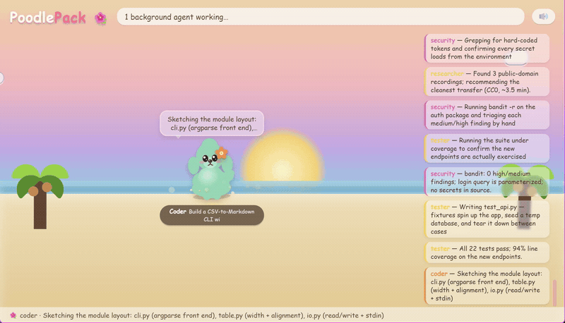
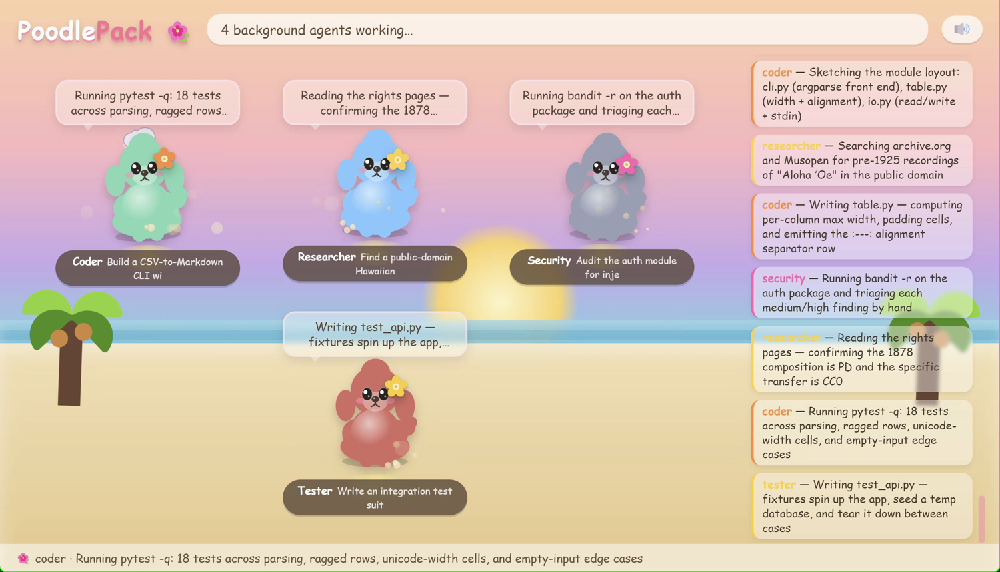
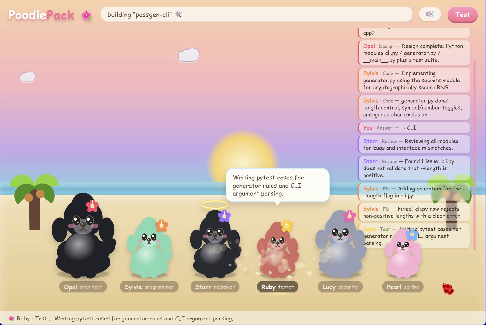

# PoodlePack 🐩🌺

**Watch your [Claude Code](https://docs.claude.com/en/docs/claude-code) agents work as a pack of poodles. Pass complex dev tasks through the Poodle Pipeline.**

PoodlePack is a pair of little Electron windows that make Claude Code's multi-agent work *visible* and *fun*. It has two modes:

- **🐾 Watch (the Kennel)** — a live dashboard that auto-opens whenever you fire **background agents**, drawing one poodle per agent with what it's doing right now, a scrolling activity log, and a confetti celebration when each finishes. It reads Claude Code's own transcripts — nothing is sent anywhere.
- **🏗️ Build (the Crew)** — a ChatDev-style pipeline where a crew of six named poodles take a one-line spec through **design → code → review → fix → test → security → docs**, animated live.



<sub>The Kennel, watching a pack work. (Asset list + capture tips in [`docs/`](docs/).)</sub>

---

## Quickstart

```bash
git clone https://github.com/aliceselizabethsmith/poodlepack.git
cd poodlepack/viz
npm install          # pulls Electron (git-ignored, so this is required once)
```

**Verify the install before going further.** Electron downloads its ~200 MB binary in a
postinstall step, separately from the npm packages. Behind a proxy, a firewall, or an offline
mirror that step can fail **silently** — `npm install` still exits 0 and prints no error, leaving
you with a package folder but no runnable Electron. Check:

```bash
node -e "console.log(require('electron'))"
```

You want an absolute path ending in `electron.exe` (Windows) or `Electron`/`electron`
(macOS/Linux). If it prints an **empty line**, the binary never arrived — `node_modules/electron/dist/`
will hold only a licence file instead of ~19 files. Re-run with a reachable mirror:

```bash
# corporate proxy
npm config set proxy http://your-proxy:port
# or point at a mirror
ELECTRON_MIRROR=https://npmmirror.com/mirrors/electron/ npm install
```

Then try a **demo** — no Claude Code needed, each plays a scripted loop (run from `viz/`):

```bash
npm run demo:pipeline    # the Poodle Pipeline (Build crew), scripted end-to-end
npm run demo:tracker     # the Poodle agent tracker (Watch kennel), scripted agents
```

---

## 🐾 Watch mode (the Kennel)

Point it at your real Claude Code session and it shows every **background** agent as a poodle:

```bash
node viz/monitor-window.mjs start    # from the repo root
```

It scans `~/.claude/projects/**/subagents/agent-*.jsonl` (Claude Code's own transcripts) and renders a live poodle per active agent — current action in a speech bubble, a scrolling chat log, dust kicked up while working, a confetti burst on finish, and a sleepy beach when the kennel's idle. It auto-fits up to 16 agents.



### Auto-launch on background agents

The whole point of the Kennel is that you don't open it — it appears when agents start. That's a Claude Code **`PostToolUse` hook** on the `Agent` tool. **Merge** this entry into the `hooks.PostToolUse` array in `~/.claude/settings.json` (don't overwrite hooks you already have) — it's **identical on Windows, macOS, and Linux**:

```json
{
  "hooks": {
    "PostToolUse": [
      { "matcher": "Agent", "hooks": [
        { "type": "command", "command": "node \"<absolute-path-to>/poodlepack/viz/monitor-window.mjs\" hook", "timeout": 10 }
      ] }
    ]
  }
}
```

Use the **absolute** path to your clone, and keep it **double-quoted** — required if the path contains spaces (e.g. a cloud-synced folder like `Proton Drive/My files/...`). The `hook` subcommand reads the tool payload on stdin and opens the Kennel only for **background** agents. Note that agents run in the background *by default*, so `run_in_background` is usually absent from the payload entirely — the check is "not `false`", not "is `true`". It's idempotent (a lockfile prevents a second window) and always exits cleanly, so it never blocks Claude Code.

**Verify it** — this should print `opening kennel` and pop the window:

```bash
echo '{"tool_input":{"run_in_background":true}}' | node "<absolute-path-to>/poodlepack/viz/monitor-window.mjs" hook
```

---

## 🏗️ Build mode (the Crew)

The Build pipeline runs **inside Claude Code** as a [Workflow](https://docs.claude.com/en/docs/claude-code). Open this repo in Claude Code and ask:

```
Run the build-app workflow to build: "a CLI that converts CSV to a Markdown table"
```

A crew of poodles hands the work down the line, each phase producing a concrete artifact for the next:

| Role | Poodle | Phase |
|------|--------|-------|
| Architect | **Opal** 🌺 (black standard) | Design → `architecture.md` |
| Programmer | **Sylvie** 🏄 (mint) | Code → `src/*` (one file per poodle, in parallel) |
| Reviewer | **Starr** 🔍 (black, haloed) | Review → findings |
| Tester | **Ruby** 🌺 (red) | Test → writes + runs tests, bounded fix loop |
| Security | **Lucy** 🦉 (grey) | Security → `bandit` / `npm audit` + AI review |
| Scribe | **Pearl** 🌙 (cream) | Docs → `README.md` |



Built apps land in `projects/<name>/`. To launch it **with the live window** from *any* workspace, install the bundled skill — copy [`skills/poodlepack/`](skills/poodlepack/) into `~/.claude/skills/`, then set `POODLEPACK_HOME` inside it to your clone path:

```bash
# macOS / Linux
mkdir -p ~/.claude/skills && cp -r skills/poodlepack ~/.claude/skills/
```
```powershell
# Windows PowerShell
New-Item -ItemType Directory -Force "$env:USERPROFILE\.claude\skills" | Out-Null
Copy-Item -Recurse -Force skills\poodlepack "$env:USERPROFILE\.claude\skills\"
```

`/poodlepack build a CLI that converts CSV to a Markdown table` then works from anywhere.

---

## Requirements

- **Node 18+** and **Electron** (installed by `npm install` in `viz/`).
- **Audio** — built in on **Windows** (the .NET MediaPlayer, nothing to install — and it correctly follows your default output device, even virtual ones like SoundWire). On **macOS/Linux** the music + chime play through **ffplay** (`brew install ffmpeg` / `sudo apt install ffmpeg`); without it, audio is a silent no-op and everything else still works.
- **Claude Code** — for real (non-demo) use: Watch reads its transcripts, Build runs as one of its Workflows.

## Platform support

**Built and tested on Windows.** macOS and Linux are written for but not yet verified — if you run it there, I'd genuinely like to hear how it went. 🐩

Nothing in the design is Windows-specific: the windows are Electron, the transcript scanner is plain Node reading files under `~/.claude/`, and the launch hook is the same JSON on every platform. Audio is the only place the code branches, using the built-in .NET MediaPlayer on Windows (which follows the system default output device, virtual ones included) and `ffplay` elsewhere. Without ffmpeg installed, audio is a silent no-op and everything else still works.

So macOS and Linux *should* be fine, and I'd rather say that plainly than claim a green tick I haven't earned. Issues and PRs from either are very welcome.

## How it works

Both windows are **fully decoupled** from the work — they communicate only through files:

- **Watch** tails Claude Code's subagent transcript `.jsonl` files and derives each agent's task/action/state.
- **Build** agents write tiny `start`/`done` event JSON files into `.devcrew/run/events/`; the window polls and animates them (see [`.devcrew/PROTOCOL.md`](.devcrew/PROTOCOL.md)).

### Note: `ELECTRON_RUN_AS_NODE`
Claude Code (and other Electron hosts) set `ELECTRON_RUN_AS_NODE=1`, which makes a spawned Electron run headless as plain Node — no window. The launch scripts strip it from the child env and spawn the real `electron` binary directly. Keep that if you edit them.

## Credits & license

Art is original (inline SVG + CSS). Music is the public-domain "Aloha ʻOe" — see [CREDITS.md](CREDITS.md). Code is [MIT](LICENSE).

🤖 Built with [Claude Code](https://claude.com/claude-code).
